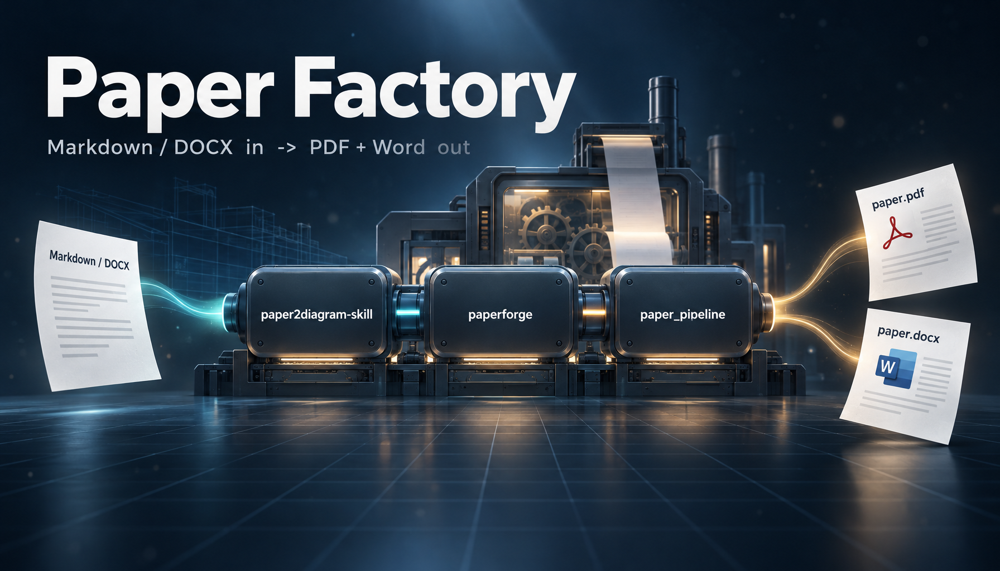
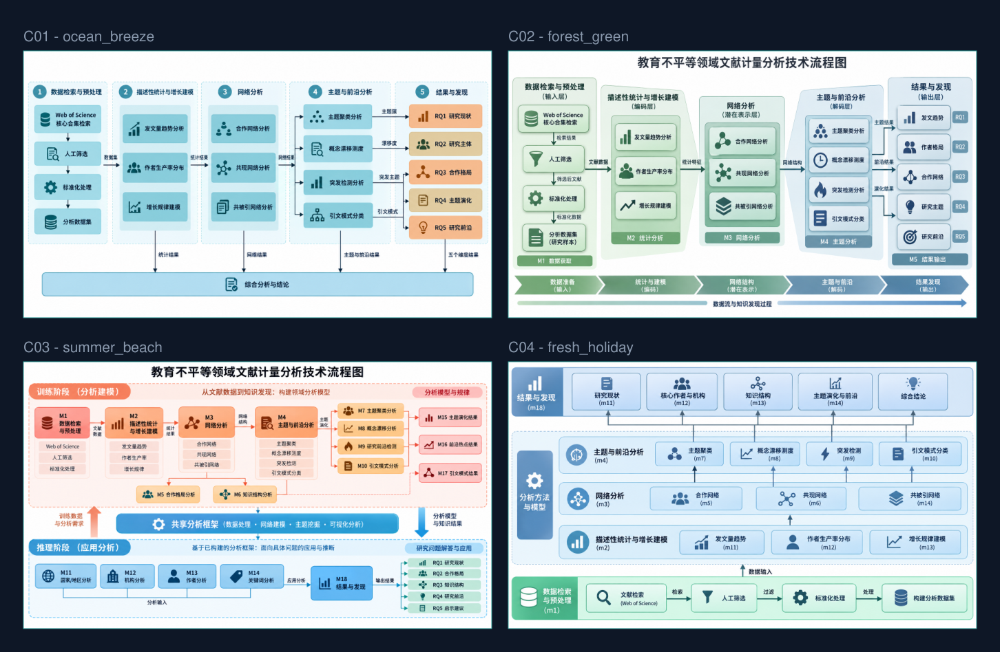
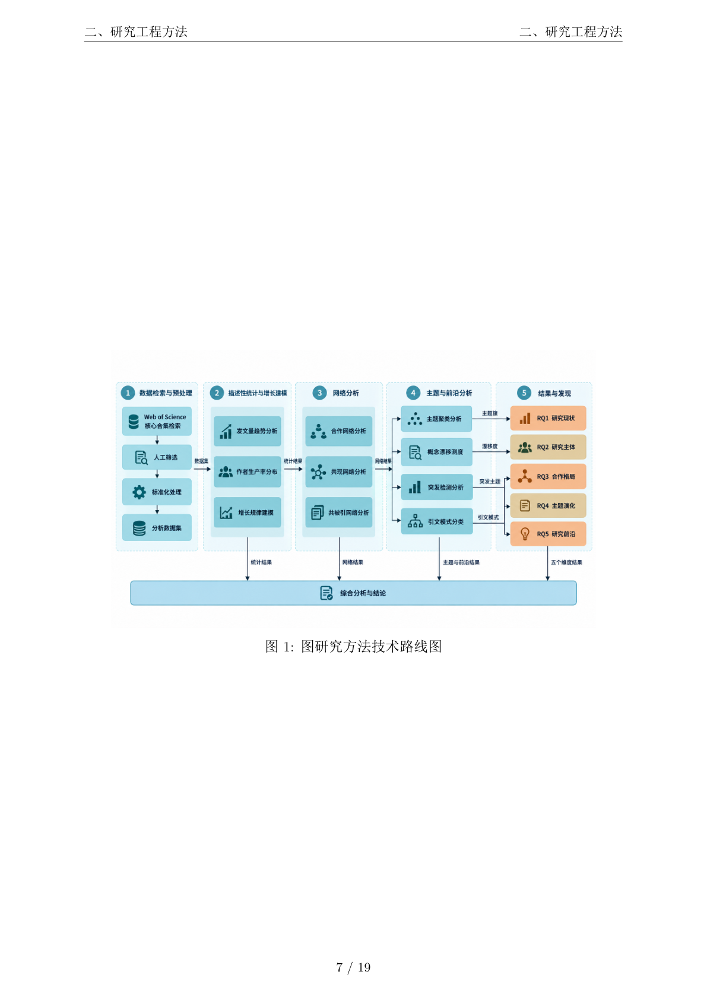

<div align="center">



# Paper Factory

**把一篇论文，自动变成"带研究框架图、可投稿级排版"的 PDF + Word**

从 Markdown/Word 输入，到 LLM 生成学术流程图、插入方法章节、LaTeX 排版、16 项 PDF 质量门校验与自动修复 —— 一条命令走完。

[](https://www.python.org/)
[](#测试)
[](LICENSE)
[](https://miktex.org/)

</div>

---

## 这是什么

`paper-factory` 是一个**学术论文自动化工作流**，由三个可独立使用、也可串联成管道的模块组成：

| 模块 | 一句话职责 | 独立能力 |
| --- | --- | --- |
| **`paperforge`** | 论文排版引擎 | `.docx` / `.md` / `.tex` → **PDF + Word 双输出**，10 套期刊/学位论文模板 |
| **`paper2diagram-skill`** | 论文 → 流程图生成器 | LLM 分析论文结构 → 结构化 Prompt → 生图模型出图（S0–S5 两轮候选） |
| **`paper_pipeline`** | 整合管道 + 质量审计 | 生图 → 插入 → 排版 → **Gate5 十六项 PDF 校验 + 自动修复**一键跑通 |

设计上刻意做了三件事，这也是它区别于"调个 API 生成个 PDF"的地方：

- **可溯源**：每个图表需求都登记到具体数据点的证据引用（claim–evidence 映射），拒绝"图好看但不知道数据哪来的"。
- **可校验**：排版结果不是"生成了就算完"，而是过 16 项 PDF 结构/格式校验，ERROR 级问题**拒绝输出**。
- **fail-closed**：密钥一律只从环境变量读取，缺失即报错退出，绝不静默降级、绝不硬编码。

---

## 效果展示

同一篇论文，`paper2diagram-skill` 会产出 **4 种布局结构**的候选图，供人工或自动择一：



选中图自动插入研究方法章节末尾，再由 `paperforge` 排成 PDF —— 22 页 A4，中文字体、三线表、页眉页脚齐备：



---

## 架构总览

```
                            ┌──────────────────────────────────────┐
   输入                     │              paper_pipeline           │
 .docx / .md   ───────────► │   Orchestrator（编排 + 质量审计）      │
                            └───┬───────────────┬──────────────┬───┘
                                │               │              │
                    ┌───────────▼──┐   ┌────────▼───────┐  ┌───▼─────────┐
                    │ paper2diagram│   │   paperforge   │  │  Gates      │
                    │  -skill      │   │                │  │  Gate5 ×16  │
                    │              │   │                │  │  + 自动修复  │
                    │ S0 论文分析   │   │ 文档解析        │  │  + 增量重编译 │
                    │ S1 策略设计   │   │ LaTeX 构建      │  │  + 错误归因   │
                    │ S2 草图探索   │   │ xelatex 编译    │  └─────────────┘
                    │ S3 方向选择   │   │ Word 构建       │
                    │ S4 候选简报   │   │ Gate1–4 校验    │
                    │ S5 正式出图   │   │                │
                    └──────────────┘   └────────────────┘
                            │               │
                            ▼               ▼
                    学术流程图 ×N      paper.pdf  paper.docx  paper.tex
```

`paper_pipeline` 采用 **CLI → Orchestrator → Services → Models → Config → Gates** 的严格分层，上层只调用紧邻下层，禁止跨层与循环依赖。

---

## 核心亮点

### 1. 生图不是"一把梭"，而是分阶段人机协作

`paper2diagram-skill` 借鉴设计工作流，把"生成一张图"拆成 **S0–S5 两轮候选**：

```
S0 论文基础分析  →  S1 策略设计  →  S2 草图探索(R1·多布局候选)
                                          │
                                          ▼
S5 正式出图(R2)  ←  S4 候选简报  ←  S3 方向选择(人工/自动指定偏好)
```

- **偏好承接**：S3 选定的风格会显式传递到 S4/S5，保证多轮之间不"跑偏"。
- **断点续跑**：每个阶段状态持久化，`--resume` 可从任意阶段继续，不必重跑已烧钱的步骤。
- **结构化 Prompt 契约**：语义图契约 + 可见文字契约 + Edge-label-first 原则，把"画得对"变成可约束的目标，而非碰运气。

### 2. 排版引擎：代码驱动，而非让 LLM 直接写 LaTeX

`paperforge` 的所有输出都是 **Python 代码确定性生成**，LLM 只负责"理解内容"，不负责"生成排版代码"，从根上规避幻觉。

- **双输入 / 双输出**：`.docx`、`.md`（以及 `.tex`）输入；PDF 与 Word **格式对齐**同时产出。
- **10 套模板 + 自动检测**：`nsfc` / `sci` / `thesis` / `renai` / `humanities` / `ieee` / `icml2025` / `cvpr2024` / `neurips2024` / `acl2024`，按语言、关键词、引用格式自动推断。
- **精细排版控制**：标题独占页、目录单开页、三线表（booktabs）、页眉页脚、多区域页码（摘要/目录罗马数字、正文阿拉伯数字、致谢无页码）。
- **公式三模式**：Unicode 可读文本 / Word 原生 OMML / 保留 LaTeX 原样。

### 3. Gate5：16 项 PDF 严格校验 + 自动修复

这是管道最有"工程味"的部分 —— 排版完成后不是结束，而是开始审计。

| # | 检测项 | 级别 | 自动修复 |
| --- | --- | --- | --- |
| 1 | 封面完整性（标题/作者） | warning | — |
| 2 | 重复参考文献标题 | **error** | ✅ |
| 3 | 二级标题左对齐 | **error** | ✅ |
| 4 | 摘要内容非空 | **error** | — |
| 5 | 关键词不单独分页 | **error** | ✅ |
| 6 | 目录独立成页 | **error** | ✅ |
| 7 | 目录条目完整性 | warning | ✅ |
| 8 | 页码格式（罗马不得晚于阿拉伯） | **error** | ✅ |
| 9 | 页眉页脚合理性 | warning | — |
| 10 | 正文字号一致性 | **error** | ✅ |
| 11 | 空白页检测 | warning | — |
| 12 | 参考文献条目格式 | warning | — |
| 13 | 图片插入检测 | warning | — |
| 14 | 图片宽高比（防拉伸） | warning | ✅ |
| 15 | PDF 可打开性 | **error** | — |
| 16 | `\cite` / `\bibitem` 对应与序号连续 | warning | ✅ |

配套机制：

- **自动修复规则库**（15 条）：如 `DUPLICATE_REF_HEADING`、`KEYWORD_ALONE`、`ROMAN_AFTER_ARABIC`、`IMAGE_ASPECT_DISTORTED` 等，按错误代码精准改写 LaTeX 源。
- **增量重编译**：修复后跳过 docx 解析，直接调 `xelatex` 重编译，**提速 50%–70%**，失败自动回退全量编译。
- **结构化日志**：JSON Lines 输出 `pipeline.log` / `pipeline_log.json`，可直接接入 CI/CD。
- **智能错误归因**：生成 `error_attribution.json`，含根因、置信度、修复建议与历史成功率。

---

## 快速开始

### 环境要求

| 依赖 | 说明 |
| --- | --- |
| Python | 3.10+ |
| XeLaTeX | MiKTeX 或 TeX Live（`paperforge` / `paper_pipeline` 排版必需） |
| LLM API | 论文结构分析、自然语言接管（OpenAI 兼容端点） |
| 生图 API | 学术流程图渲染（OpenAI 兼容 `images.generate` 端点） |

### 1. 安装依赖

```bash
pip install -r requirements.txt
```

<details>
<summary>或按模块手动安装</summary>

```bash
pip install pyyaml python-docx requests openai python-dotenv pydantic PyMuPDF
```

</details>

### 2. 配置密钥（只走环境变量）

```bash
cp .env.example .env     # 然后填入你自己的密钥
```

或用环境变量注入（PowerShell）：

```powershell
$env:LLM_API_KEY   = "sk-你的LLM密钥"
$env:IMAGE_API_KEY = "sk-你的图片API密钥"
```

> ⚠️ `.env` 已被 `.gitignore` 忽略。本项目**从不**把密钥写入代码或配置文件，`.env.example` 中也不含任何真实值。

### 3. 运行

**方式 A — 一键跑完整链条（生图 → 插入 → 排版 → Gate5 审计）**

```bash
cd paper_pipeline
python run.py ../examples/input/sample_paper.md --work-dir ../workspace
```

**方式 B — 只生成流程图**

```bash
cd paper2diagram-skill
python paper2diagram.py ../examples/input/sample_paper.md          # S0–S5 完整两轮候选
python paper2diagram.py ../examples/input/sample_paper.md --quick  # 快速单次出图
```

**方式 C — 只做排版（PDF + Word 双输出）**

```bash
cd paperforge
python config/process_lunwen_v4.py ../examples/input/sample_paper.md -t auto -o ../build_out
```

> `paperforge` 需以其自身目录为工作目录运行（内部按相对路径解析模板与资源）。

---

## 示例与产物

`examples/` 里放了一条完整链路的真实产物（已匿名化），方便你直接对照输出格式：

```
examples/
├── input/
│   └── sample_paper.md              # 输入：一篇文献计量分析论文
├── output/                          # 排版成品（PDF 的源与中间产物）
│   ├── paper_final.md / .tex        #   英文版
│   └── paper_final_zh.md / .tex     #   中文版
├── figure_specs/
│   ├── figure_requirements.md       # 图表需求清单（人类可读）
│   └── analysis_result.v2.json      # 上游分析结果的完整 artifact（证据底座）
└── artifact_bundle/                 # 一次完整交付的数据包
    ├── paper/                       #   manuscript_source(.md/.tex/.json)、paper_manifest.json
    ├── figures/figure_request.json  #   图表需求（含 claim–evidence 溯源）
    ├── refs/                        #   reference_request / writing_support_request
    └── README.md                    #   该交付包的字段级说明
```

一次管道运行的典型输出目录：

```
workspace/<run>/
├── diagrams/                  # 生成的学术流程图
├── build/paper.pdf            # 最终 PDF（已插入流程图）
├── build/paper.docx           # 同结构 Word
├── build/paper.tex            # LaTeX 源（含位置标记）
├── pipeline.log               # 结构化日志（JSON Lines）
├── pipeline_log.json          # 日志汇总
└── error_attribution.json     # 错误归因报告（仅检测失败时生成）
```

> 更多说明见 [`examples/README.md`](examples/README.md)。

---

## 项目结构

```
paper-factory/
├── api_config.py                # ★ 全项目统一 API 配置中心（唯一密钥读取入口）
├── .env.example                 # 环境变量模板（不含真实值）
├── requirements.txt
├── paperforge/                  # 排版引擎
│   ├── config/                  #   process_lunwen_v4.py（主入口）、nl_pipeline.py
│   ├── core/                    #   文档解析 / LaTeX 构建 / Word 构建 / 模板 / 公式 / 校验
│   ├── gates/                   #   Gate1–Gate4 质量门
│   ├── templates/               #   10 套模板 YAML + BibTeX 样式
│   └── workflows/               #   .tex 重新排版工作流
├── paper2diagram-skill/         # 论文 → 流程图
│   ├── paper2diagram/
│   │   ├── llm/                 #   论文分析 / Prompt 生成 / 配色 / 布局变体
│   │   ├── image/               #   生图（超时 + 重试 + 异常分类）
│   │   └── templates/           #   布局模板 YAML
│   ├── paper2diagram.py         #   主入口（S0–S5）
│   └── requirements.txt
├── paper_pipeline/              # 整合管道
│   ├── run.py                   #   一键入口
│   ├── src/paper_pipeline/
│   │   ├── cli.py               #   参数解析（最薄层）
│   │   ├── core/                #   Orchestrator / manifest 校验 / 清单构建
│   │   ├── services/            #   DiagramService / TypesetService
│   │   ├── gates/               #   Gate5 / 结构化日志 / 错误归因
│   │   ├── models/              #   dataclass / Pydantic 数据模型
│   │   └── config/              #   settings.py（配置中心）
│   └── tests/                   #   118 项测试
└── examples/                    # 真实链路产物示例
```

---

## 测试

`paper_pipeline` 带完整测试套件（质量门规则、路径解析、artifact 校验、异常体系等）：

```bash
cd paper_pipeline
python -m pytest -q
# 118 passed
```

测试环境会主动清空 `LLM_API_KEY` / `IMAGE_API_KEY` 等变量，并断言默认路径中**不残留任何硬编码绝对盘符** —— 用测试守住"无硬编码"这条红线。

---

## 配置说明

统一配置入口是根目录的 [`api_config.py`](api_config.py)，密钥只从环境变量读取：

| 变量 | 用途 | 默认值 |
| --- | --- | --- |
| `LLM_API_KEY` | LLM 密钥（论文分析 / 自然语言接管） | **必填** |
| `LLM_BASE_URL` | LLM 端点 | `https://api.deepseek.com/v1` |
| `LLM_MODEL` | LLM 模型 | `deepseek-chat` |
| `IMAGE_API_KEY` | 生图密钥 | **必填** |
| `IMAGE_BASE_URL` | 生图端点 | `https://api.openai.com/v1` |
| `IMAGE_MODEL` | 生图模型 | `gpt-image-2` |
| `IMAGE_TIMEOUT` / `IMAGE_MAX_RETRIES` / `IMAGE_TOTAL_TIMEOUT` | 生图超时与重试 | `300` / `3` / `900` |
| `DIAGRAM_S2_COUNT` / `DIAGRAM_S5_COUNT` | R1 / R2 候选数量 | `4` / `4` |
| `DIAGRAM_PALETTES` | 配色方案列表 | `ocean_breeze,forest_green,summer_beach,fresh_holiday` |
| `TYPESET_TEMPLATE` | 排版模板（`auto` 为自动检测） | `auto` |
| `TYPESET_XELATEX_TIMEOUT` | 单次编译超时（秒） | `600` |
| `MIKTEX_BIN` | MiKTeX 二进制目录（留空自动探测） | 自动 |

---

## 设计原则

1. **禁止硬编码** —— 密钥、路径、格式参数一律来自环境变量或配置文件。
2. **类型安全** —— 数据传递使用 dataclass / Pydantic，不用裸字典。
3. **禁止跨层调用** —— 上层只调用紧邻下层。
4. **禁止循环依赖** —— 模块间不得互相缠绕。
5. **异常携带上下文** —— 所有异常必须带完整上下文（入参、状态、失败阶段）。
6. **fail-closed** —— 必需配置缺失时立即失败，不静默降级。

---

## 已知限制

| 现象 | 原因 | 处理 |
| --- | --- | --- |
| 首次 `xelatex` 编译很慢 | MiKTeX 需建立字体缓存 | 属一次性开销，之后恢复正常 |
| Gate3 报 `xelatex not found` | Gate3 不读取自定义 MiKTeX 路径 | 该警告不影响实际编译 |
| 生图质量依赖提示词与模型 | 提示词契约只能约束、不能完全保证 | S3 人工方向选择 + 多候选对比 |

---

## 许可

[MIT](LICENSE) © 2026 Ave-Nir